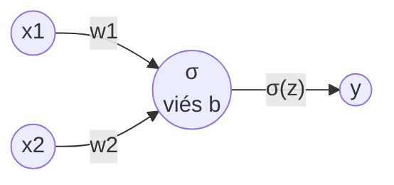
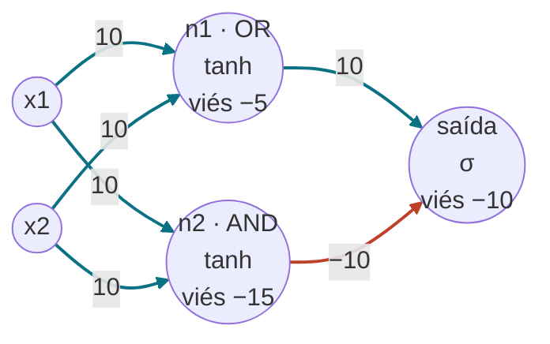

# Pesos e vieses: como a rede enxerga AND, OR e XOR

Este documento explica os números que o `train_xor.py` imprime e mostra onde cada
um atua na rede. A versão interativa (com seleção de entrada) está em
[`diagrama.html`](../diagrama.html).

Nos diagramas, setas **verdes** são pesos positivos (empurram a saída para 1) e
setas **vermelhas** são pesos negativos (empurram para 0).

## 1. Um neurônio: AND e OR

Com `--hidden 0` a rede é um neurônio só:

```
z = w1·x1 + w2·x2 + b
y = σ(z)
```



Pesos aprendidos com `--seed 0` e 2000 épocas:

| Porta | w1 | w2 | viés b | Perda final |
|---|---|---|---|---|
| AND | 11,40 | 11,46 | −17,17 | 0,0025 |
| OR | 11,71 | 11,85 | −5,43 | 0,0020 |

Os pesos são quase iguais nas duas portas, porque AND e OR são simétricos nas
entradas. **O viés é o que diferencia as portas**, pois ele define o limiar:

- **AND:** com uma entrada, z = 11,4 − 17,2 = −5,8 (saída ≈ 0). Com as duas,
  z = 22,9 − 17,2 = +5,7 (saída ≈ 1). O limiar da soma `x1 + x2` fica perto de 1,5.
- **OR:** com nenhuma entrada, z = −5,4 (saída ≈ 0). Com uma, z = 11,7 − 5,4 = +6,3
  (saída ≈ 1). O limiar cai para perto de 0,5.

Geometricamente, o neurônio traça uma reta no plano (x1, x2) e o viés a desloca.

## 2. XOR: dois neurônios escondidos

Nenhuma reta separa o XOR, então entra uma camada no meio. Estes são os pesos
escolhidos à mão em `hand_built.py`:



- **n1 = tanh(10·(x1 + x2 − 0,5))** vale ≈ +1 se alguma entrada for 1 (OR).
- **n2 = tanh(10·(x1 + x2 − 1,5))** vale ≈ +1 só se as duas forem 1 (AND).
- **saída = σ(10·n1 − 10·n2 − 10)** vale 1 quando é OR mas não AND, ou seja, XOR.

Cálculo para cada entrada:

| x1, x2 | z de n1 | n1 | z de n2 | n2 | z da saída | saída | esperado |
|---|---|---|---|---|---|---|---|
| 0, 0 | −5 | −1,00 | −15 | −1,00 | −10 | 0,0000 | 0 |
| 0, 1 | +5 | +1,00 | −5 | −1,00 | +10 | 1,0000 | 1 |
| 1, 0 | +5 | +1,00 | −5 | −1,00 | +10 | 1,0000 | 1 |
| 1, 1 | +15 | +1,00 | +5 | +1,00 | −10 | 0,0000 | 0 |

Na última linha, n1 e n2 ligam juntos, e o peso −10 de n2 cancela o +10 de n1.
É isso que faz o (1, 1) dar 0.

## 3. Onde cada número aparece no PyTorch

`model.named_parameters()` para `--hidden 2`, com os valores da rede feita à mão:

| Nome | Formato | No diagrama | Valor |
|---|---|---|---|
| `0.weight` | (2, 2) | setas das entradas para n1 e n2 | `[[10, 10], [10, 10]]` |
| `0.bias` | (2) | viés de n1 e de n2 | `[−5, −15]` |
| `2.weight` | (1, 2) | setas de n1 e n2 para a saída | `[[10, −10]]` |
| `2.bias` | (1) | viés da saída | `[−10]` |

São 9 parâmetros (4 + 2 + 2 + 1). Com `--hidden 4` são 17, mas a lógica é a mesma:
cada neurônio escondido é uma reta, e a saída combina as retas.

Os valores aprendidos por treino mudam a cada semente (neurônios trocados de lugar,
sinais invertidos, alguns redundantes). O que se repete é a função aprendida,
não os números.
